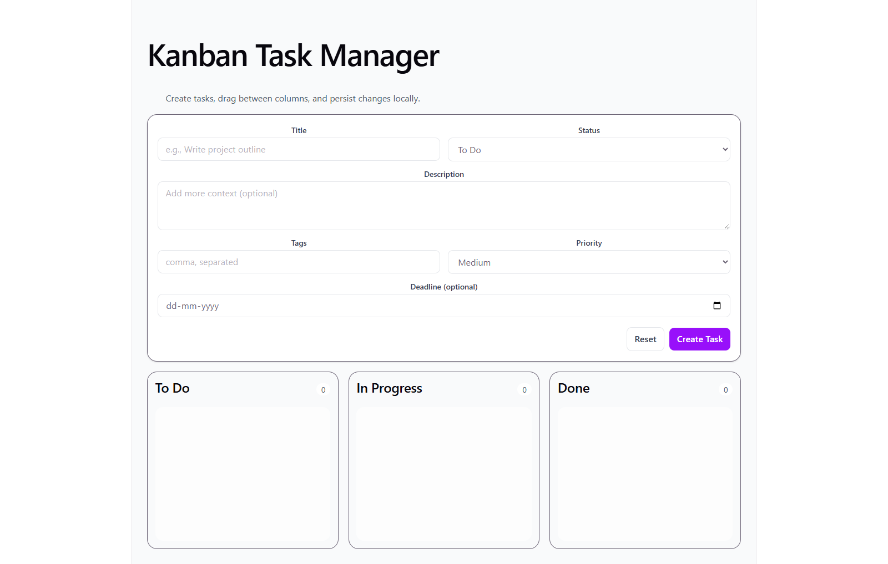
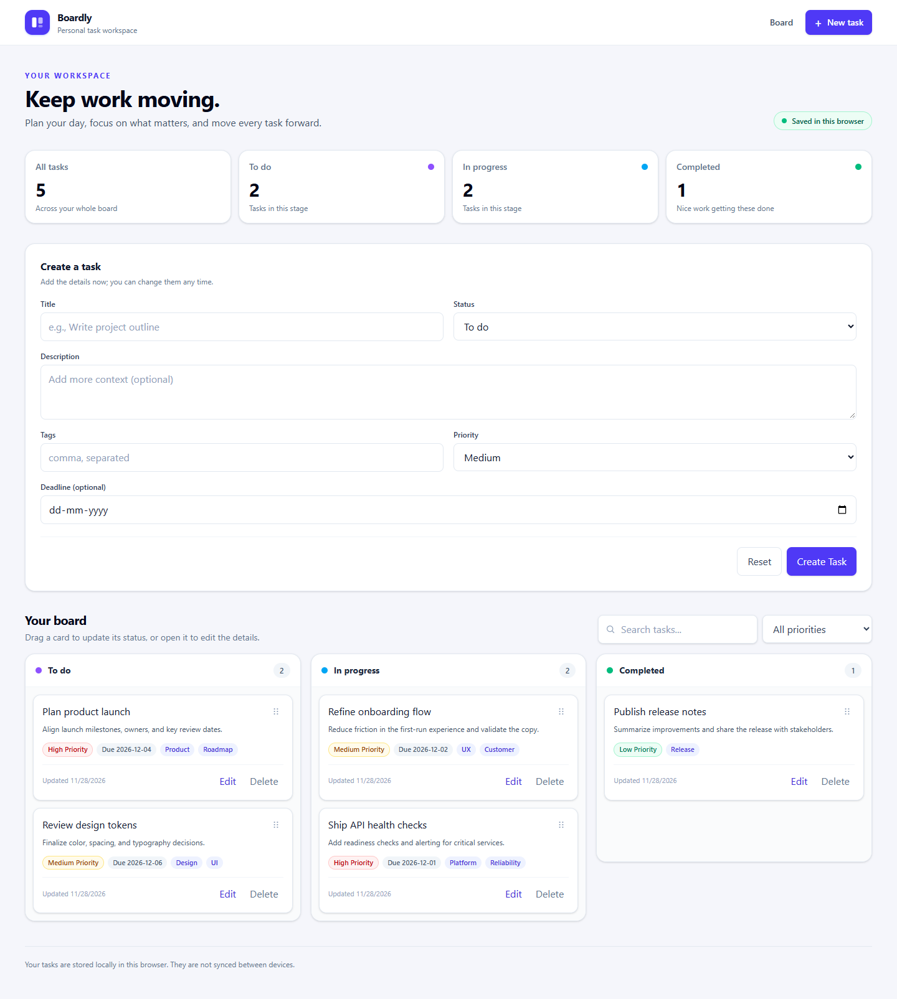
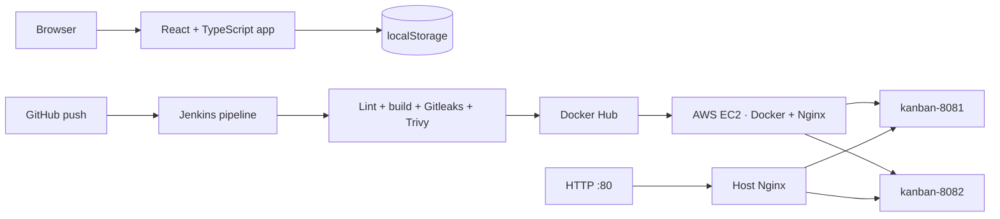

<div align="center">
  
  <h1>Kanban Task Manager</h1>
  <p><strong>A local-first task board, backed by a production-minded delivery pipeline.</strong></p>
  <p>
    <a href="http://16.4.49.225/">Live application (HTTP)</a>
    &nbsp;·&nbsp;
    <a href="https://hub.docker.com/r/prateekdz/kanban-dashboard">Docker Hub image</a>
    &nbsp;·&nbsp;
    <a href="./screenshots/README.md">Screenshot gallery</a>
  </p>
  <p>
    
    
    
    
    
  </p>
</div>

---

## Main application layout



<p align="center"><em>The supplied local application layout is the primary project presentation.</em></p>

## Additional design exploration



<p align="center"><em>Boardly is an extra local visual refresh with synthetic demo tasks, not the primary project layout or a live-deployment screenshot.</em></p>

## Overview

The Kanban Task Manager is a browser-based task board organized around three workflow states: **To do**, **In progress**, and **Completed**. It pairs a React application with a Jenkins pipeline that builds, scans, publishes, and deploys a Docker image using a blue-green Nginx switch. The Boardly preview above is a supplemental visual refresh.

The app is intentionally local-first: tasks are saved in the current browser's `localStorage`. There is no account system, API, or cross-device synchronization.

## Project goal and scope

The goal is to demonstrate both a usable frontend and a controlled container delivery path: validate source changes, scan the image, publish versioned tags, then move traffic between two application containers. Board data remains client-side; this project is not a multi-user task service.

## What it does

- Create, edit, and delete tasks with descriptions, priorities, tags, and optional deadlines.
- Move tasks between columns with drag-and-drop or the keyboard-accessible drag handle.
- Search task titles, descriptions, and tags; filter the board by priority.
- See total and per-column task counts.
- Preserve unreadable saved data until the user explicitly confirms replacement.
- Use the interface across desktop, tablet, and mobile layouts.

## Data and persistence

Tasks contain a title, description, workflow status, priority, tags, optional ISO-date deadline, and creation/update timestamps. The versioned board is stored under the `kanbanTasksV1` key in browser storage. Storage is scoped to the current browser profile and device.

If existing data is malformed or storage is unavailable, the UI warns the user and avoids silently overwriting the saved value. Replacing saved data requires an explicit action.

## Architecture



Jenkins creates the Nginx site configuration during deployment. A separate Nginx configuration file and standalone deployment script are not currently tracked in this repository.

## Technology

| Layer | Tools |
| --- | --- |
| Frontend | React 18, TypeScript 5, Tailwind CSS 4 |
| Build and checks | Vite 8, ESLint, Playwright |
| Container | Multi-stage Docker build, unprivileged Nginx runtime |
| CI/CD | Jenkins Declarative Pipeline |
| Image security | Gitleaks and Trivy |
| Registry and host | Docker Hub and AWS EC2 |

## Project structure

```text
.
├── Dockerfile
├── Jenkinsfile
├── index.html
├── public/kanban-mark.svg
├── scripts/kanban-smoke-test.mjs
├── src/
│   ├── components/TaskBoard/
│   ├── context/TaskContext.tsx
│   ├── lib/storage.ts
│   └── types/
├── screenshots/     # Supplied evidence images and current UI preview
└── evidence/        # Stage indexes linking to screenshots/
```

Original screenshots are preserved locally in the Git-ignored `screenshots-original/` directory; they are not included in the repository or Docker build context.

## Run locally

**Requirements:** Node.js 24 and npm.

```sh
npm ci
npm run dev
```

Open the Vite URL printed in the terminal (normally `http://localhost:5173`).

### Quality checks

```sh
npm run lint
npm run build
```

The Playwright smoke test covers task creation/editing, search, priority filtering, drag-and-drop, persistence, and recovery from invalid saved data. Start the Vite server first, then run:

```sh
npm run test:smoke
```

The test uses Playwright's installed Chromium by default. If Google Chrome is installed instead, set `PLAYWRIGHT_BROWSER_CHANNEL=chrome` before running it.

## Run with Docker

Build and run the production image:

```sh
docker build -t kanban-dashboard:local .
docker run --rm --name kanban-dashboard --memory=512m --cpus=1.0 -p 8080:8080 kanban-dashboard:local
```

Open `http://localhost:8080`. Check the container health status with:

```sh
docker inspect --format '{{.State.Health.Status}}' kanban-dashboard
```

The final image contains the static build served by Nginx, not the Node build environment. The configured publishing target is [`prateekdz/kanban-dashboard`](https://hub.docker.com/r/prateekdz/kanban-dashboard).

## CI/CD and deployment

The Jenkins pipeline runs these stages:

1. **Checkout** the configured Git revision.
2. **Test** with `npm ci`, ESLint, and the production build.
3. **Build & Tag** with the Jenkins build number and 12-character commit SHA.
4. **Scan** the source with Gitleaks and the image with Trivy (HIGH/CRITICAL findings fail the scan).
5. **Push** both tags to Docker Hub using Jenkins credentials.
6. **Deploy & Switch Traffic** to the inactive container, with `--memory=512m --cpus=1.0`.
7. **Post** cleanup of dangling Docker images on the Jenkins agent.

The deployment host runs Nginx on port 80 and binds the two application colors to loopback ports 8081 and 8082. Jenkins checks the candidate container before switching Nginx. It backs up `kanban.conf`, validates and reloads Nginx, and checks the public URL before stopping the previous container. On handled switch failures, the pipeline attempts to restore the previous config and removes the failed candidate.

### Jenkins setup

Follow the [official Jenkins Linux installation guide](https://www.jenkins.io/doc/book/installing/linux/), install a supported Java runtime, enable Jenkins, and complete the setup wizard with authentication enabled. Install Pipeline, Git, Credentials Binding, and GitHub integration plugins.

Create a Pipeline job that loads this repository's `Jenkinsfile` from `main`. Run it on a Linux agent with Docker CLI/daemon access and the required Nginx/systemd permissions.

#### Credentials

- Configure a Jenkins **Username with password** credential with ID `dockerhub-credentials`. Use the Docker Hub username and an access token with the required push/pull permissions.
- If the source repository is private, configure a separate read-only GitHub checkout credential.
- Never store secrets in source, build parameters, screenshots, or console output.

The repository does not contain AWS credentials. The deployment host must be able to pull from Docker Hub and reach `PUBLIC_URL`. Docker daemon access is root-equivalent; use a dedicated agent and narrowly scoped `sudo` rules.

#### GitHub webhook

Webhook configuration is separate from the Jenkinsfile. Point GitHub to the reachable Jenkins webhook endpoint, normally `https://<jenkins-host>/github-webhook/`, and enable **GitHub hook trigger for GITScm polling** on the job. Verify a successful GitHub delivery and a corresponding webhook-started build.

The supplied webhook screenshot says the hook had never been triggered at capture time. A historical manual build is not proof of webhook delivery.

#### AWS host and network

Use a Linux EC2 host with Docker Engine, Nginx, `curl`, `sudo`, and `systemd`. Recommended ingress rules:

- Allow TCP 80 as needed for public HTTP.
- Restrict SSH (TCP 22) to administrator IP ranges.
- Keep container ports 8081/8082 private; the pipeline binds them to loopback.
- Restrict Jenkins UI access to trusted networks or protect it with authenticated HTTPS.
- Do not expose an unauthenticated Docker daemon socket.

Use an EC2 instance profile only if AWS API access is added; the current pipeline does not require long-lived AWS access keys.

## Security and operations

- The runtime uses the unprivileged Nginx image as UID 101 and declares a Docker health check.
- `.dockerignore` excludes local dependencies, build output, environment files, screenshots, and evidence.
- The Docker Hub token is bound from Jenkins credentials and passed through `docker login --password-stdin`; do not store secrets in source or screenshots.
- Base-image tags are mutable. Pin verified image digests if reproducible production builds are required.
- The live site currently uses plain HTTP. Do not send sensitive information through it.
- CloudWatch, centralized log retention, and alerting are not configured.

Useful host checks:

```sh
docker ps --filter name=kanban-
docker logs --tail 100 kanban-8081
docker stats --no-stream
sudo nginx -t
sudo systemctl status nginx --no-pager
curl -fsS http://16.4.49.225/
```

## Screenshots and evidence

- [Screenshot gallery and original-filename mapping](./screenshots/README.md) contains the primary app capture, the optional Boardly preview, and 19 supplied screenshots.
- [Stage-based evidence index](./evidence/README.md) links to the same images without duplicating them.
- Originals are preserved locally in the Git-ignored `screenshots-original/` folder; review them for sensitive AWS and host details before sharing.

The supplied captures do **not** include Gitleaks/Trivy output or a dedicated rollback test. The webhook capture says the hook had never been triggered at capture time. Historical screenshots do not prove that the current local revision is deployed.

## Verification status

| Check | Result |
| --- | --- |
| `npm run lint` | Pass |
| `npm run build` | Pass |
| `npm run test:smoke` | Pass using installed Google Chrome |
| Responsive layout | No horizontal overflow observed at 390px and 1440px |
| Live endpoint | `http://16.4.49.225/` returned HTTP 200 during the latest check |
| Docker image build/run | Not verified locally; the Docker daemon was unavailable |
| Current Jenkins/AWS deployment | Not verified from this worktree |

The redesigned UI in this repository has not been published by this change. A successful Jenkins deployment is required before it appears on the live site.
