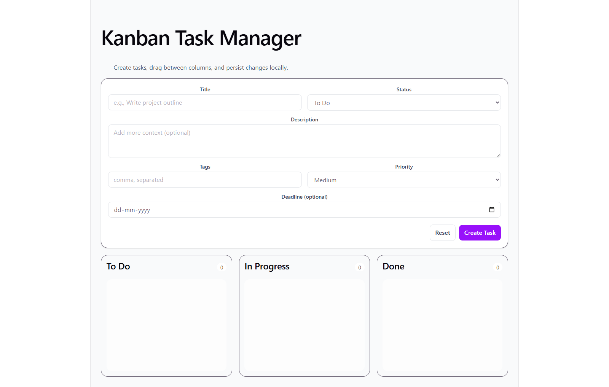
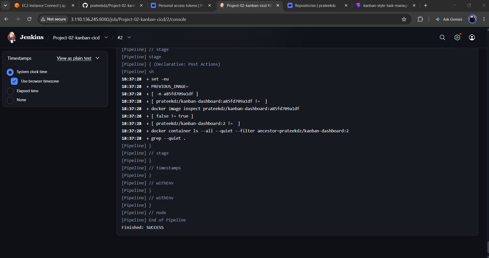
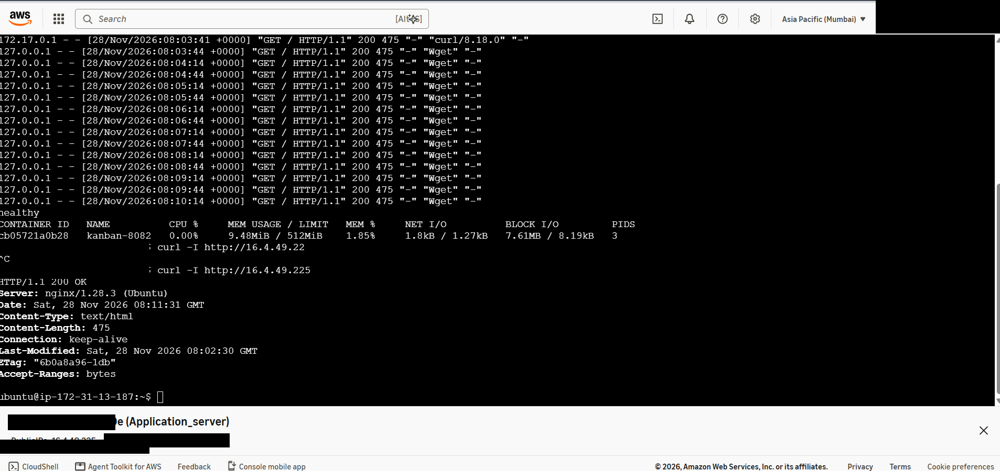
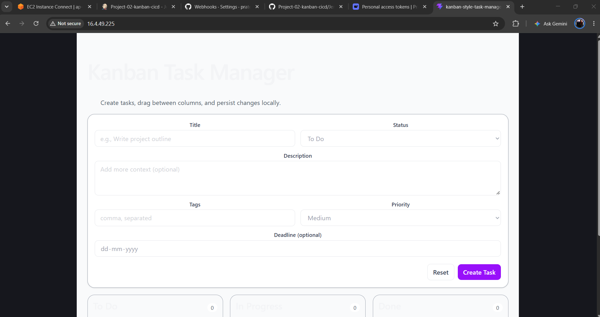

# Deployment evidence

This directory is the stage-based evidence index. Screenshots are stored once in [`screenshots/`](../screenshots/README.md), which lists the retained images. Missing screenshots are identified explicitly rather than represented as completed evidence.

| Folder | Supplied evidence |
| --- | --- |
| [01-local-application](./01-local-application/README.md) | Local UI, Vite server, browser, and task interaction; project-structure and local HTTP-response screenshots are absent |
| [02-docker-build](./02-docker-build/README.md) | Docker engine and Hello World smoke test only; no project image-build screenshot was supplied |
| [03-docker-security](./03-docker-security/README.md) | No Gitleaks or Trivy scan screenshot was supplied |
| [04-docker-hub](./04-docker-hub/README.md) | Docker Hub repository page showing the `v1` tag |
| [05-aws-ec2](./05-aws-ec2/README.md) | EC2 shell, Docker service, and container resource output |
| [06-jenkins](./06-jenkins/README.md) | Jenkins initial setup and dashboard |
| [07-github-webhook](./07-github-webhook/README.md) | Webhook settings screenshot; it states the hook had never been triggered at capture time |
| [08-pipeline-success](./08-pipeline-success/README.md) | Historical Jenkins build #2 marked successful; captured before the latest pipeline changes |
| [09-pipeline-failure](./09-pipeline-failure/README.md) | Jenkins build history showing build #1 failed; no failure console output was supplied |
| [10-health-check](./10-health-check/README.md) | Green container and public HTTP 200 check |
| [11-rollback](./11-rollback/README.md) | No rollback-test screenshot was supplied |
| [12-live-application](./12-live-application/README.md) | Live Kanban application |

## Local application

## Pipeline success

## Health check

## Live application

