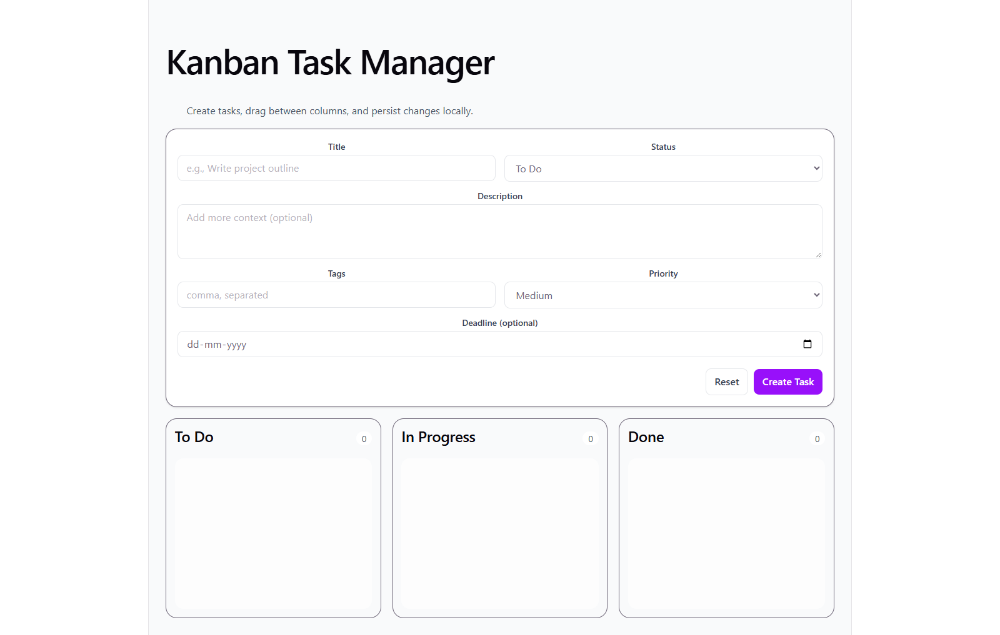
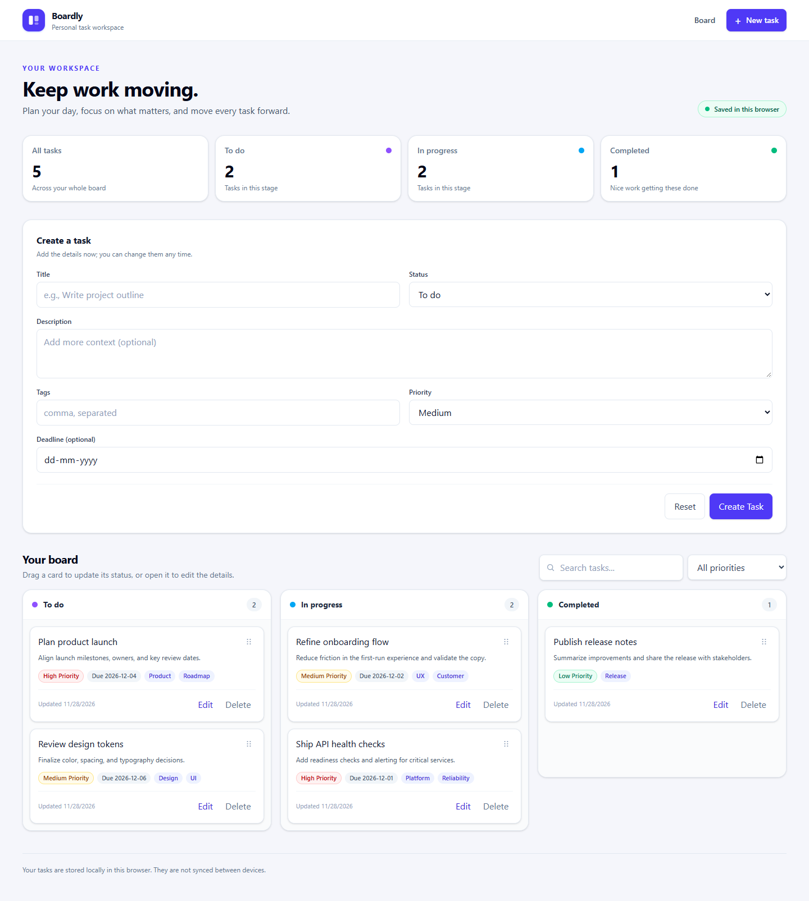

# Screenshots and evidence

This is the single image store. The `evidence/` directory contains stage-based indexes that link here, avoiding duplicate image copies.

## Main application layout

This supplied local application screenshot represents the primary project layout.

## Additional Boardly design

This is an extra local design exploration captured with synthetic demo tasks. It is not the primary project layout or a screenshot of the live deployment, and is intentionally not mapped to a supplied original screenshot.

## Supplied screenshot mapping

The following 19 descriptive copies correspond one-to-one with the supplied originals. The originals remain unchanged in the locally Git-ignored `screenshots-original/` folder. Remove passwords, access tokens, and private keys before sharing screenshots.

| Original filename | Renamed copy |
| --- | --- |
| `02-project-structure.png` | [01-project-structure.png](./01-local-application/01-project-structure.png) |
| `03-local-application.png` | [02-local-application.png](./01-local-application/02-local-application.png) |
| `04-local-curl-response.png` | [03-local-curl-response.png](./01-local-application/03-local-curl-response.png) |
| `Screenshot 2026-11-26 132310.png` | [01-docker-engine-smoke-test.png](./02-docker-build/01-docker-engine-smoke-test.png) |
| `Screenshot 2026-11-26 140059.png` | [04-vite-dev-server.png](./01-local-application/04-vite-dev-server.png) |
| `Screenshot 2026-11-26 140524.png` | [05-local-browser.png](./01-local-application/05-local-browser.png) |
| `Screenshot 2026-11-26 140725.png` | [06-task-interaction.png](./01-local-application/06-task-interaction.png) |
| `Screenshot 2026-11-26 151701.png` | [01-dockerhub-repository-tag.png](./04-docker-hub/01-dockerhub-repository-tag.png) |
| `Screenshot 2026-11-27 130738.png` | [01-ec2-shell.png](./05-aws-ec2/01-ec2-shell.png) |
| `Screenshot 2026-11-27 134042.png` | [02-docker-service-active.png](./05-aws-ec2/02-docker-service-active.png) |
| `Screenshot 2026-11-27 142615.png` | [01-jenkins-unlock-screen.png](./06-jenkins/01-jenkins-unlock-screen.png) |
| `Screenshot 2026-11-27 143810.png` | [02-jenkins-dashboard.png](./06-jenkins/02-jenkins-dashboard.png) |
| `Screenshot 2026-11-27 183801.png` | [01-console-success.png](./08-pipeline-success/01-console-success.png) |
| `Screenshot 2026-11-27 183822.png` | [01-build-history-with-failed-run.png](./09-pipeline-failure/01-build-history-with-failed-run.png) |
| `Screenshot 2026-11-27 183857.png` | [02-successful-build-details.png](./08-pipeline-success/02-successful-build-details.png) |
| `Screenshot 2026-11-27 192453.png` | [01-webhook-not-triggered.png](./07-github-webhook/01-webhook-not-triggered.png) |
| `Screenshot 2026-11-28 131941.png` | [03-container-resource-usage.png](./05-aws-ec2/03-container-resource-usage.png) |
| `Screenshot 2026-11-28 134222.png` | [01-live-application.png](./12-live-application/01-live-application.png) |
| `Screenshot 2026-11-28 134249.png` | [01-green-container-http-200.png](./10-health-check/01-green-container-http-200.png) |

## Evidence status

- The Docker CLI screenshot shows an engine/Hello World check, not a build of this project image.
- No Gitleaks or Trivy scan screenshot was supplied.
- The webhook screenshot says the hook had never been triggered at capture time.
- Build screenshots are historical and do not prove that the current source revision was deployed.
- No dedicated rollback-test screenshot was supplied.
- The live-app and EC2 screenshots are capture-time evidence, not continuous monitoring.

The missing security-scan and rollback captures are recorded in the corresponding folders as unavailable; no evidence has been fabricated.
